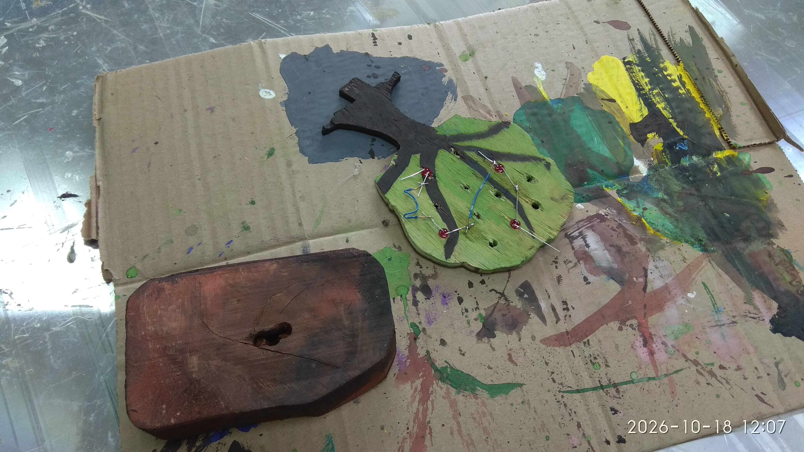
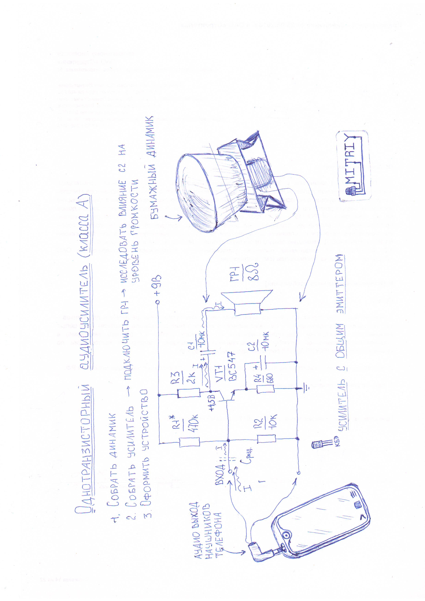

## Структура комментария

### Заголовок комментария
Тестирование загрузки медиа

### Основной текст
Проверка восстановления ссылок разных форматов, определения повторных файлов и работы с несколькими фотографиями и видео.

### Подвал комментария
Тестовый черновик. Не публиковать.

## 📸 Фотоматериалы

### Заголовок блока
Фото: варианты ссылок на один файл

### Описание блока
Один и тот же физический файл указан разными способами. Проверяем, распознаются ли все варианты и появляется ли диалог повторного прикрепления.

### Медиафайлы
![[IMG_JPG_test1.jpg|Obsidian embed alias]]
[[IMG_JPG_test1.jpg|Obsidian link alias]]

[Markdown link — описание](IMG_JPG_test1.jpg)

[MediaWiki | photo_01.jpg](IMG_JPG_test1.jpg)

[IMG_JPG_test1.jpg | photo_01.jpg](IMG_JPG_test1.jpg)
[Markdown angle URL](<IMG_JPG_test1.jpg>)
[[2026-11-10-1794354000_discussion_11_eaststandart_photo_01.jpg|Тест физического имени photo_01]]

## 📸 Фотоматериалы

### Заголовок блока
Фото: разные физические файлы

### Описание блока
Проверка нескольких вложений и разных поддерживаемых форматов изображений в одном блоке.

### Медиафайлы
![[IMG_PNG_test1.png|PNG Obsidian embed]]
[[IMG_test2.jpg|JPG Obsidian link]]

[WebP — изображение автомобиля](avtomobil-s-polnym-privodom-iz-kartona-02.webp)

## 🎥 Видеоматериалы

### Заголовок блока
Видео: варианты ссылок на один файл

### Описание блока
Один MP4-файл указан несколькими синтаксисами. Проверяем восстановление и поиск повторного прикрепления.

### Медиафайлы
![[VID_test1.mp4|Obsidian embed video]]
[[VID_test1.mp4|Obsidian ordinary video]]

[Markdown link — видео](VID_test1.mp4)

[MediaWiki | video_01.mp4](VID_test1.mp4)

[VID_test1.mp4 | video_01.mp4](VID_test1.mp4)
[Markdown angle URL](<VID_test1.mp4>)

## 🎥 Видеоматериалы

### Заголовок блока
Видео: разные файлы и расширения

### Описание блока
Проверка нескольких MP4 и WebM файлов в одном блоке.

### Медиафайлы
![[VID_20261104_144452.mp4|Видео MP4]]
[VID_MP4_10mb.mp4](VID_MP4_10mb.mp4)

[[muzykalnyj-karandash-01.webm|Видео WebM]]
