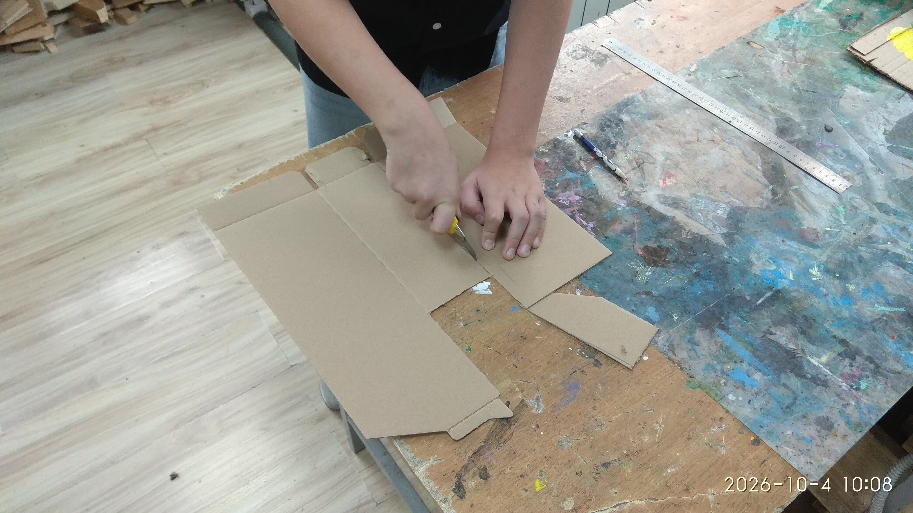

# Комментарий для публикации

## Структура комментария

### Заголовок комментария

Проверка полного цикла обработки медиакомплекта

### Основной текст

Повторный тест после восстановления подробного отчёта двух режимов видеосжатия. Проверка двух MP4, подходящего WebM, двух JPG и WebP.

### Подвал комментария

Тестовый комплект. Публикация предназначена для проверки технического конвейера.

## Фотоматериалы

### Заголовок блока

Фотографии — Markdown

### Описание блока

Проверка преобразования JPG в WebP.

### Медиафайлы

## Фотоматериалы

### Заголовок блока

Дополнительная фотография

### Описание блока

Проверка сохранения подходящего WebP без повторного преобразования.

### Медиафайлы

## Видеоматериалы

### Заголовок блока

Видеозаписи — WikiLink

### Описание блока

Проверка двух режимов кодирования CRF 25 и 700 kbps.

### Медиафайлы

![[test_video_01.mp4]]
![[test_video_02.mp4]]

## Видеоматериалы

### Заголовок блока

Дополнительное видео

### Описание блока

Проверка сохранения подходящего WebM без перекодирования.

### Медиафайлы

![[test_video_03.webm]]
