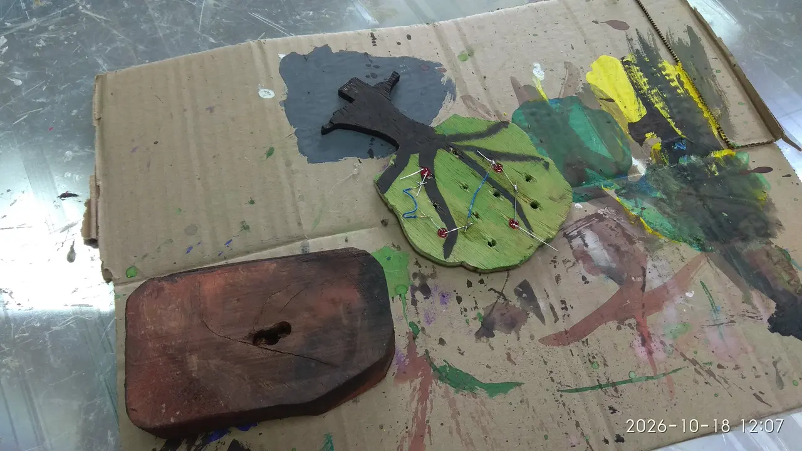
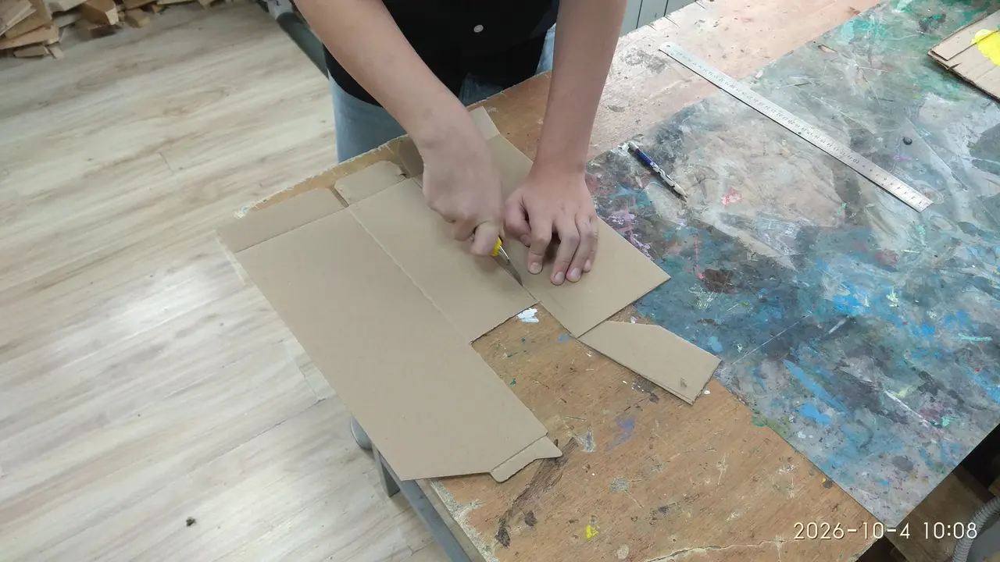

# Проверка полного цикла

Проверка реальной предварительной обработки, стандартизации имён, обработки исходных JPEG и MP4, транзитных WebP и WebM, передачи комплекта в _output и сигнала comment-notify.

## Фотоматериалы

### Исходные JPEG

### Транзитный WebP

## Видеоматериалы

### Исходные MP4
![[2026-11-21-1795249106_discussion_83_TechLab_video_01.webm]]
![[2026-11-21-1795249106_discussion_83_TechLab_video_02.webm]]

### Транзитный WebM
![[2026-11-21-1795249106_discussion_83_TechLab_file_video-03.webm]]
