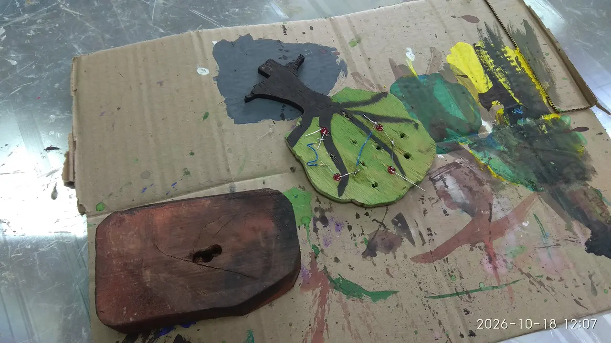
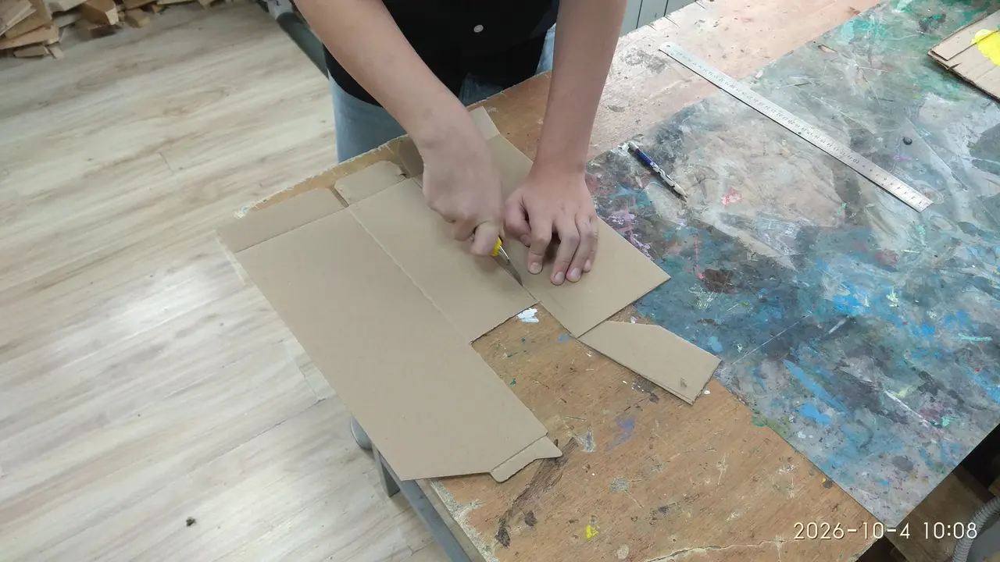

# Комментарий для публикации

## Структура комментария

### Заголовок комментария

Тест полного цикла обработки медиакомплекта

### Основной текст

Проверка полного процесса подготовки и передачи медиакомплекта: несколько фото- и видеоблоков, разные форматы ссылок, стандартизация имён файлов, оптимизация изображений и видео, а также передача готового комплекта в папку _output.

### Подвал комментария

Тестовый комплект. Публикация предназначена для проверки технического конвейера.

## 📸 Фотоматериалы

### Заголовок блока

Фотографии — Markdown

### Описание блока

Первый фотоблок. Файлы подключены встроенными Markdown-ссылками.

### Медиафайлы

## 📸 Фотоматериалы

### Заголовок блока

Дополнительная фотография

### Описание блока

Проверка дополнительного формата изображения WebP в структуре фотоблока.

### Медиафайлы

## 🎥 Видеоматериалы

### Заголовок блока

Видеозаписи — WikiLink

### Описание блока

Первый видеоблок. Файлы подключены встроенными Obsidian Wiki-ссылками.

### Медиафайлы

![[2026-11-21-1795495619_discussion_83_TechLab_video_01.webm]]
![[2026-11-21-1795495619_discussion_83_TechLab_video_02.webm]]

## 🎥 Видеоматериалы

### Заголовок блока

Дополнительное видео

### Описание блока

Проверка входного видео в формате WebM как транзитного файла.

### Медиафайлы

![[2026-11-21-1795495619_discussion_83_TechLab_video_03.webm]]
